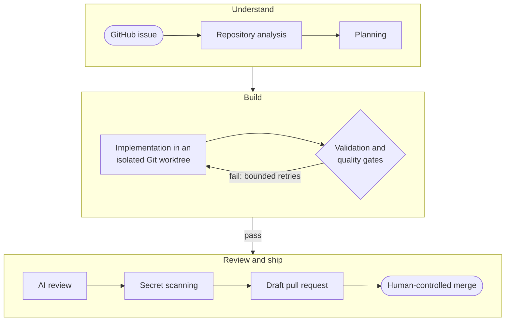

# Hi, I'm Chaitanya Kalbhairav 👋

**Backend Engineer | Application Security | AI Developer Tooling**

🎓 B.Tech CSE (Artificial Intelligence), VIT Pune (2023–2027) | CGPA **8.7** | SGPA **9.54** 
📍 Pune, India

I like owning systems end to end, from the database schema to the app store listing. I was the sole engineer behind **[Petometo](https://petometo.com)**, a pet-care platform live on Google Play and the App Store, where I took the backend from a MongoDB soft launch to a hardened Spring Boot + PostgreSQL modular monolith. Most recently I interned on the **Security Team at Temple**, building eBPF-based API security tooling. On the side, I built **GrootCode Beet**, an AI system that turns GitHub issues into draft pull requests, with a human in control of every merge.

---

## 💼 Experience

### Temple
**Software Developer Intern, Security Team** | Gurugram, India | Jun 2026 – Jul 2026 
Brain-health wearable company founded by Deepinder Goyal (Founder, Zomato/Eternal)

- **eBPF API security inventory:** Built and deployed a system that combines static source analysis with runtime traffic discovery to map application attack surfaces and flag discrepancies between declared and observed APIs.
- **Application security assessments:** Performed authorized security assessments and reverse engineering across mobile and REST API workflows, validated behavior through controlled testing, and documented vulnerabilities with remediation guidance.
- **AI-assisted remediation:** Prototyped an issue-to-PR workflow covering repository analysis, fix planning, automated validation, and draft pull request generation, reducing manual effort across security and engineering remediation.

### Petometo
**Software Engineer Intern (Project-Based)** | Pune, India | Mar 2025 – Oct 2025 
All-in-one pet care platform, built and shipped as the sole developer

  
    
  &nbsp;
  &nbsp;
  
   
  📜 <a href="https://drive.google.com/file/d/1taQg26aQZGianE783QpQXt2UBWx0gDZ3/view">Letter of Appreciation</a>

- **End-to-end ownership:** Built the Flutter app shipped to Google Play and the Apple App Store, the Next.js web app, and the Spring Boot backend, delivering authentication, booking workflows, Razorpay payments, AWS S3 media storage, FCM notifications, and multi-environment deployments.
- **Re-architected for production:** After the MongoDB-based soft launch, rebuilt the backend as a Java/Spring Boot modular monolith on PostgreSQL, using JPA/Hibernate and Flyway to enforce domain boundaries, transactional consistency, database constraints, and concurrency-safe business workflows.
- **Hardened security and reliability:** Spring Security, JWT access tokens with rotating refresh-token families and replay revocation, OTP throttling, resource-level authorization, transactional outboxes, idempotent retries, Testcontainers-backed integration and concurrency tests, and OpenTelemetry-based observability.
- **Load-tested:** 1,000 virtual users across 10K requests with 81 ms average latency, ~100 ms p95, and a 0.2% error rate.
- **Grew discoverability:** Next.js SEO and search-indexing work reached 25K+ Google Search impressions in one month. Selected to present Petometo at a Y Combinator startup event in Bangalore (2026).

         

<b>Load test details (Apache JMeter)</b>

 

| Virtual users | Requests | Avg latency | p95 latency | Throughput | Error rate |
| :---: | :---: | :---: | :---: | :---: | :---: |
| 1,000 | 10,000 | ~81 ms | ~100 ms | ~99 req/s | ~0.2% |

Optimizations included HTTP caching, ETag validation, and optimized database queries.

### Reticulo Sports Technology
**Intern (Project-Based)** | Pune, India | Oct 2024 – Dec 2024 | [Internship Letter](https://drive.google.com/file/d/1pP3l1owGkI1rMKkZDU30Ru5hswgTv4BA/view)

- **Closed-loop embedded control:** Engineered and validated a closed-loop RPM control system in C/C++ for an ESP32-based shuttle launcher, reaching 1-second actuation cycles at ~80% lower manufacturing cost than commercial alternatives. Iterated through prototype testing and secured 50+ pre-orders.
- **Offline TOTP authentication:** Built an RFC 6238-compliant TOTP system that generates secure credentials for 200+ users without network connectivity.

 

---

## 🧠 Projects

### GrootCode Beet: AI Software Engineering System (2026)

   

An autonomous GitHub issue-to-PR system. Given an issue, it analyzes the repository, plans the change, implements it in an isolated Git worktree, validates it against quality gates, reviews it with AI, and opens a draft pull request, with bounded retries, secret scanning, and human-controlled merges.

### More builds

| Project | What it does | Stack |
| :-- | :-- | :-- |
| [**Travel AI**](https://github.com/Gitkbc/Gen_Ai_Tourism) Multi-agent, multilingual itinerary orchestrator | Breaks unpredictable LLM generation into a strict 6-stage pipeline (discovery, culinary intelligence, ranking, clustering, priority, routing) with JSON schema validation, deterministic scoring outside the LLM, caching, and parallel async execution. Narrates guides in each language's native script using concurrent text-to-speech. | FastAPI, Python (asyncio), LLMs, gTTS |
| [**AI Telephony Agent**](https://github.com/Gitkbc/Call_Agents) Real-time conversational voice agent | Handles conversational voice calls, schedules meetings automatically, generates full transcripts, and includes a live monitoring dashboard. | FastAPI, React, MongoDB, Twilio, LiveKit, Deepgram |

---

## 🌍 Open Source

**10+ merged pull requests** across two open-source communities:

| Project | Contributions |
| :-- | :-- |
| [**OneBusAway**](https://github.com/OneBusAway) Open-source real-time transit information platform | [Merged PRs](https://github.com/OneBusAway/vehicle-positions/pulls?q=is%3Apr+author%3AGitkbc+is%3Amerged) to the Go/PostgreSQL `vehicle-positions` service: architecture and database-layer (sqlc) documentation, a Docker build fix, and Go build hygiene. Also contributing to the [OneBusAway Android app](https://github.com/OneBusAway/onebusaway-android/pulls?q=is%3Apr+author%3AGitkbc). |
| [**terminal.lua**](https://github.com/lunarmodules/terminal.lua) Cross-platform terminal library for Lua | [Merged PRs](https://github.com/lunarmodules/terminal.lua/pulls?q=is%3Apr+author%3AGitkbc+is%3Amerged) adding ANSI formatting support in progress sprites, an editline out-of-bounds fix, cursor tests for negative indices, a text-stack refactor, and new examples. |

---

## 🧰 Tech Stack

| Area | Tools |
| :-- | :-- |
| **Languages** |         |
| **Backend** |       |
| **Frontend & Mobile** |    |
| **Data** |       |
| **Cloud & DevOps** |       |
| **Security** |      |
| **Testing** |     |
| **Observability** |       |
| **AI & Voice** |     |
| **Embedded** |   |

---

## 🏆 Achievements & Leadership

- **Research:** 3+ published papers; received an award at an international conference.
- **Y Combinator startup event (2026):** Selected to present Petometo in Bangalore.
- **Leadership:** Coordinator, Microsoft Learn Student Club, VIT Pune.
- **Beyond code:** All-India level badminton player; 2 Olympiad medals.

---

## 📊 GitHub Activity

  

 

  Always building. Always learning. Always shipping.

