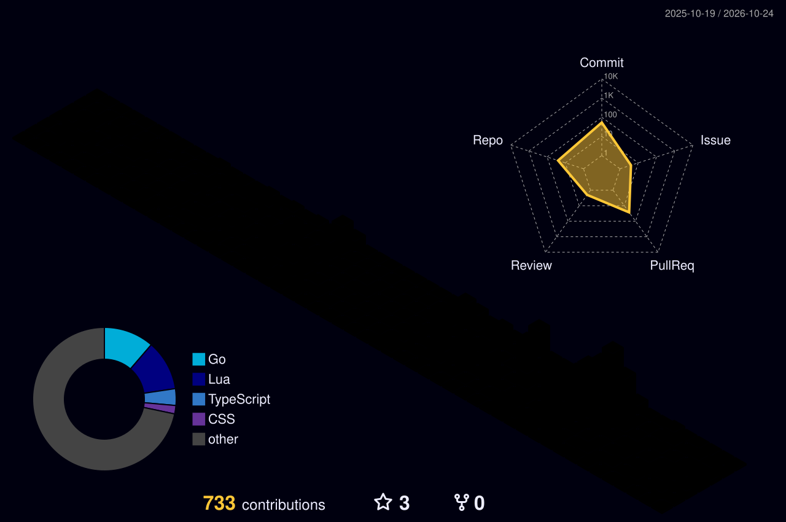

<h1>Hi, I'm Chaitanya Kalbhairav 👋</h1>

<strong>Software Engineer | Backend Systems · Application Security · AI Infrastructure</strong>

  I build secure backend systems and developer tooling, and I enjoy taking products from prototype to production.

  <a href="https://github.com/Gitkbc">GitHub</a> ·
  <a href="https://www.linkedin.com/in/chaitanya-kalbhairav-60162028b/">LinkedIn</a> ·
  <a href="mailto:chaitanyakalbhairav@gmail.com">Email</a>

B.Tech, Computer Science & Engineering (Artificial Intelligence) · VIT Pune · 2023–2027

What I work on
- Backend engineering: Java/Spring Boot, REST APIs, PostgreSQL, transactions, concurrency, and distributed-workflow reliability.
- Application security: API attack-surface discovery, eBPF-based runtime visibility, authentication, and authorization.
- AI developer tooling: Agent-based repository analysis, automated validation, and human-reviewed issue-to-PR workflows.
- Product engineering: Building and shipping web, mobile, cloud, and embedded systems end to end.
Professional Experience
🔐 Temple Pvt. Ltd. — Software Developer Intern, Security Team
Jun 2026 – Jul 2026 · Gurugram, India
Company: Temple — a brain-health wearable startup founded by Deepinder Goyal, founder of Zomato/Eternal. Temple develops a head-worn wearable focused on physiological monitoring.
- API attack-surface visibility: Built and deployed an eBPF-based API security inventory that combined static source analysis with runtime traffic discovery to identify gaps between declared and observed APIs.
- Application security: Conducted authorized security assessments and reverse engineering across mobile and REST API workflows; validated findings through controlled testing and documented remediation guidance.
- AI-assisted remediation: Prototyped an issue-to-PR workflow for repository analysis, fix planning, automated validation, and draft pull request creation.
Focus: eBPF · API Security · Runtime Observability · Reverse Engineering · AI-Assisted Engineering
🐾 Petometo — Software Engineer Intern (Project-Based)
Mar 2025 – Oct 2025 · Pune, India

  
  
<strong>Petometo — All-in-One Pet Care Platform</strong>

  
A platform that helps pet parents discover, book, and manage care from independent local service providers.

  

    <a href="https://petometo.com">Website</a> ·
    <a href="https://play.google.com/store/apps/details?id=com.petometo.app">Google Play</a> ·
    <a href="https://apps.apple.com/us/app/petometo/id6756202185">App Store</a> ·
    <a href="https://drive.google.com/file/d/1taQg26aQZGianE783QpQXt2UBWx0gDZ3/view?usp=drivesdk">Letter of Appreciation</a>
  

- End-to-end ownership: Worked as the sole developer, shipping a Flutter mobile app to Google Play and the App Store, a Next.js web application, and a Spring Boot backend spanning authentication, bookings, Razorpay payments, AWS S3 media, and FCM notifications.
- Backend architecture: Evolved the MongoDB-based soft launch toward a PostgreSQL-backed modular monolith, applying Spring Data JPA/Hibernate, Flyway, database constraints, transactional consistency, and concurrency-safe workflows.
- Security and reliability: Implemented Spring Security, JWT access tokens, rotating refresh-token families, replay revocation, OTP throttling, resource-level authorization, transactional outboxes, and idempotent retries.
- Verification and observability: Used Testcontainers-backed integration/concurrency tests and OpenTelemetry-based observability; load-tested 1,000 virtual users over 10,000 requests.
- Launch and discoverability: Improved search indexing and SEO, reaching 25K+ Google Search impressions in one month; selected to present Petometo at a Y Combinator startup event in Bengaluru (2026).

<strong>Backend load-test results (JMeter)</strong>

Virtual users	Requests	Average response	P95 latency	Error rate
1,000	10,000	81 ms	~100 ms	0.2%

These figures describe a specific load-test run, not a continuous production SLA.

Stack: Java · Spring Boot · Spring Security · PostgreSQL · MongoDB · Flyway · Flutter · Next.js · AWS · Docker · Testcontainers · OpenTelemetry
⚙️ Reticulo Sports Technology — Intern (Project-Based)
Oct 2024 – Dec 2024 · Pune, India
- Engineered a closed-loop ESP32 shuttle-launcher control system in C/C++, achieving approximately 1-second actuation cycles and 80% lower manufacturing cost than commercial alternatives; prototype iterations helped secure 50+ pre-orders.
- Developed an offline TOTP authentication solution based on RFC 6238, enabling code generation for 200+ users without network connectivity.
Stack: Embedded C/C++ · ESP32 · Control Systems · TOTP
Featured Engineering Project
🤖 GrootCode Beet — AI Software Engineering System (2026)
An agent-driven GitHub issue-to-draft-PR system built with Python, FastAPI, Claude Agent SDK, and Docker.
- Orchestrates repository analysis, planning, implementation, automated validation, AI-assisted review, and draft PR generation.
- Uses isolated Git worktrees, explicit quality gates, bounded retries, and secret scanning to constrain automated changes.
- Keeps merge decisions under human control rather than treating AI-generated changes as automatically production-ready.
Focus: Agent Orchestration · Developer Tooling · Repository Automation · CI/Validation · Secure Execution

<strong>Additional projects</strong>

Travel AI — Multilingual Itinerary Orchestrator
Built a six-stage itinerary generation pipeline using FastAPI, Python asyncio, and LLMs, with structured outputs, deterministic ranking, and multilingual text-to-speech generation.

AI Conversational Telephony Agent
Developed a real-time voice-agent prototype using FastAPI, React, MongoDB, Twilio, LiveKit, and Deepgram for conversational calling, transcription, scheduling, and monitoring.

Technical Toolkit

Area	Tools & technologies
Languages	Java, Go, Python, TypeScript, SQL, C/C++, Lua, Dart
Backend	Spring Boot, Spring Security, Spring Data JPA, Hibernate, REST APIs, FastAPI, Maven
Frontend & mobile	Next.js, React, Flutter
Data	PostgreSQL, MongoDB, Redis, Firestore, Flyway, PostGIS
Cloud & delivery	AWS (S3, SES, KMS, Lambda), Docker, Docker Compose, GitHub Actions, Firebase/FCM
Testing & security	JUnit 5, Mockito, Testcontainers, JMeter, OWASP ZAP, JWT, OAuth 2.0, RBAC, eBPF
Observability	OpenTelemetry, Prometheus, Grafana, Loki, Tempo, Micrometer

Open Source & Recognition
- Open source: 10+ merged pull requests across OneBusAway and terminal.lua, including Go/PostgreSQL backend work, Android, terminal UI, tests, docs, and developer tooling.
- Research: 3+ published papers and an award at an international conference.
- Leadership: Coordinator, Microsoft Learn Student Club.
- Education: B.Tech CSE (AI), Vishwakarma Institute of Technology, Pune (2023–2027) · CGPA 8.7 · SGPA 9.54.
GitHub Contributions

  

  <strong>Interested in backend engineering, application security, AI infrastructure, and developer tooling.</strong>
  
<a href="mailto:chaitanyakalbhairav@gmail.com">Get in touch</a> · <a href="https://www.linkedin.com/in/chaitanya-kalbhairav-60162028b/">Connect on LinkedIn</a>

